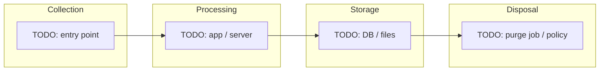

# Privacy Impact Assessment (PIA)

Structure aligned with **NPC Advisory No. 2017-03** (Privacy Impact Assessments). Not legal advice.

**PIC:** TODO: legal entity  
**PIP (if separate):** TODO: or N/A  
**DPO:** TODO: name, contact  
**System / product:** TODO: name  
**Assessment date:** TODO: YYYY-MM-DD  
**Version:** TODO: e.g. 1.0  

---

## I. Description of processing

### I.A Program / project / system overview

TODO: What the system does, primary users, deployment context (e.g. LAN box, cloud region, mobile web).

### I.B Necessity and proportionality

TODO: Why personal data is needed; less intrusive alternatives considered.

### I.C Roles

| Role | Name / unit | Responsibility |
| ---- | ----------- | -------------- |
| PIC | TODO: | Accountability |
| PIP | TODO: | |
| DPO | TODO: | Advisory, compliance coordination |
| System owner | TODO: | Operations |

---

## II. Scope

### II.A In scope

TODO: Modules, environments (prod/staging), user types (guest, member, staff, minors if any).

### II.B Out of scope

TODO: Explicit exclusions (e.g. third-party identity provider not operated by PIC).

### II.C Legal and regulatory frame

- **RA 10173** (Data Privacy Act of 2012) and IRR  
- Applicable NPC issuances: TODO: list (registration, consent/notice, security, sector guidance)  
- TODO: Other laws (e.g. sector DRR mandates)—cite only if confirmed  

---

## III. Data inventory

Attach or embed the filled **`templates/data-inventory.md`** for this system.

**Summary count:** TODO: N categories PI · TODO: SPI · TODO: PrI  

---

## IV. Data lifecycle

Map each major data type through the phases below. Cross-check **`references/lifecycle-checklist.md`**.

| Phase | What happens | Data types | Controls / gaps |
| ----- | ------------ | ---------- | ----------------- |
| Collection | TODO | | |
| Use / processing | TODO | | |
| Storage | TODO | | |
| Sharing / disclosure | TODO | | |
| Retention | TODO | | |
| Disposal / deletion | TODO | | |

### IV.A Workflow diagram

Replace nodes with actual components from the target system.

---

## V. Privacy principles (DPA Sec. 11) — yes / no / partial

Answer **Yes**, **No**, or **Partial**; cite evidence or gap in the **Remarks** column.

| # | Principle (Sec. 11) | Y / N / Partial | Remarks |
| - | ------------------- | --------------- | ------- |
| 1 | Transparency to data subjects | | |
| 2 | Legitimate purpose specified before collection | | |
| 3 | Proportionality | | |
| 4 | Collected for specified legitimate purposes only | | |
| 5 | Processed fairly and lawfully | | |
| 6 | Accurate and up to date where necessary | | |
| 7 | Adequate, relevant, not excessive | | |
| 8 | Retained only as long as necessary for purpose or as required by law | | |

### V.B Lawful processing grounds

| Processing activity | Personal data type | Sec. 12 or 13 ground | Documentation location |
| ------------------- | ------------------ | -------------------- | ---------------------- |
| TODO | | | |

---

## VI. Risks and mitigating controls

| Risk ID | Description | Likelihood (L/M/H) | Impact (L/M/H) | Existing controls | Residual risk | Action owner | Target date |
| ------- | ----------- | ------------------ | -------------- | ----------------- | ------------- | ------------ | ----------- |
| R1 | TODO: unauthorized access | | | | | TODO: | |
| R2 | TODO: excessive retention | | | | | | |
| R3 | TODO: inaccurate data | | | | | | |

Link OWASP Privacy Risks P1–P10 where relevant (**`references/lifecycle-checklist.md`**).

---

## VII. Security measures (DPA Sec. 20; Circular 2023-06)

### VII.A Organizational

TODO: policies, training, access governance, vendor management.

### VII.B Physical

TODO: device/site controls for servers and operator access.

### VII.C Technical

TODO: encryption in transit/at rest, authentication, logging, patching, backup security.

| Measure | Implemented (Y/N/Partial) | Evidence (doc / config / ticket) |
| ------- | ------------------------- | -------------------------------- |
| TODO | | |

---

## VIII. Data sharing and cross-border transfer

| Recipient | Purpose | Data | Safeguards | Agreement |
| --------- | ------- | ---- | ---------- | --------- |
| TODO: or None | | | | |

---

## IX. Data subject rights

| Right (DPA Sec. 16; Advisory 2021-01) | Channel in product / org | SLA / process | Gap |
| ------------------------------------- | ------------------------ | --------------- | --- |
| Informed | | | |
| Access | | | |
| Rectification | | | |
| Erasure / blocking | | | |
| Object | | | |
| Portability (if applicable) | | | |
| File complaint | | | |

---

## X. Disposal and retention

| Data type | Retention period | Disposal method | Responsible role | Verified (Y/N) |
| --------- | ---------------- | --------------- | ---------------- | -------------- |
| TODO | | | | |

**Backup / archive:** TODO: how backups are purged or expired.

---

## XI. Child-oriented processing (if applicable)

**Advisory 2024-03:** TODO: N/A or describe child PIA factors, default privacy, guardian involvement.

---

## XII. Approval

| Name | Role | Signature / date |
| ---- | ---- | ---------------- |
| TODO: | DPO | |
| TODO: | PIC representative | |

**Next review trigger:** TODO: e.g. major release, new processor, purpose change, annual (Advisory 2025-02 Sec. 4.E.2).
